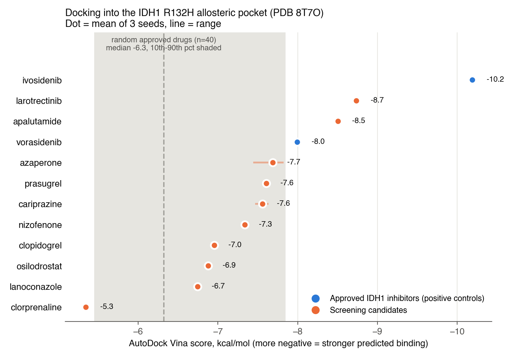
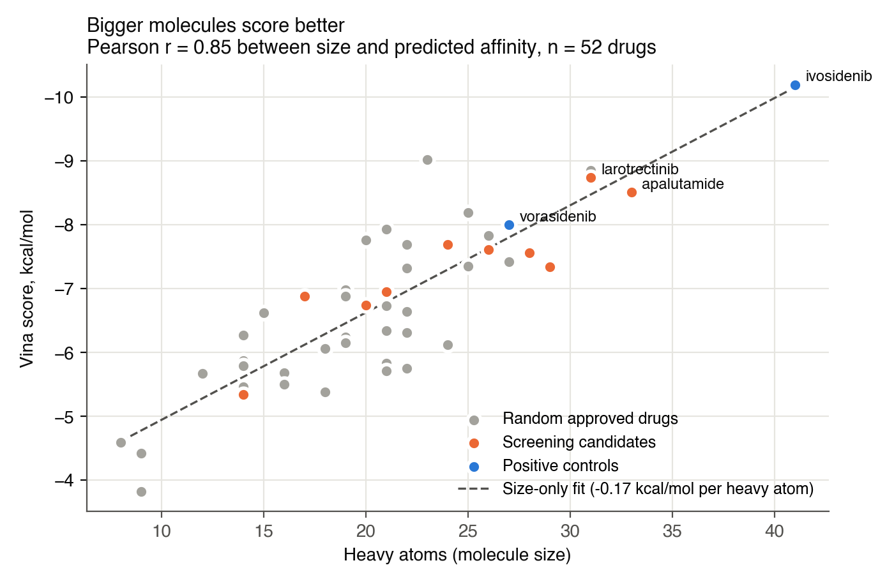

# Drug Repositioning for IDH1-Mutant Glioma: Cheminformatics Screen + Docking

**Goal:** look for FDA-approved drugs that might be repurposed against the IDH1 R132H mutation that drives many gliomas, by combining a ligand-based screen (drug-likeness, brain penetration, similarity to the IDH1 inhibitor ivosidenib) with structure-based docking into the IDH1 R132H inhibitor pocket.

**Result:** the screening funnel narrowed 2,712 approved drugs to 10 candidates. After docking them into the inhibitor pocket with a validated setup, **larotrectinib (-8.7 kcal/mol) and apalutamide (-8.5) had the best raw scores**, better than vorasidenib (-8.0, an approved IDH inhibitor) and 38 of 40 random approved drugs, though short of ivosidenib (-10.2). **But docking scores here track molecule size closely (r = 0.85), and after adjusting for size, neither candidate stands out:** larotrectinib scores only 0.26 kcal/mol better than its size predicts (rank 17 of 52), and apalutamide scores worse than its size predicts. Even the two approved IDH inhibitors sit on the size line. So this docking setup does not separate real inhibitors from random drugs, and the candidates are **weak leads to test in an enzyme assay, not evidence of binding.**



## Pipeline
| Step | Tool | Output |
|---|---|---|
| 1. Load library | pandas | Broad Drug Repurposing Hub: 7,540 drugs, 22,612 sample rows |
| 2. Approved drugs | pandas | 2,712 unique launched/Phase 4 drugs, 2,702 with valid SMILES |
| 3. Drug-likeness | RDKit descriptors, relaxed Lipinski (MW up to 600, since ivosidenib is 583 Da) | 1,950 drugs |
| 4. Brain penetration | TPSA < 90, MW < 500, LogP > 1 (CNS heuristic, because glioma is in the brain) | 1,132 drugs |
| 5. Similarity | Morgan fingerprints (radius 2, 2,048 bits), Tanimoto to ivosidenib | Top 10 candidates |
| 6. Receptor | PDB **8T7O** (IDH1 R132H dimer bound to ivosidenib), chains A + B, Open Babel at pH 7.4 | `structures/receptor_AB.pdbqt` |
| 7. Validation | Redock ivosidenib, compare to the crystal pose | RMSD (see below) |
| 8. Docking | AutoDock Vina 1.2.7, 22 Å box on the crystal ivosidenib, exhaustiveness 16, 3 seeds | `results/docking_summary.csv` |
| 9. Context | 2 approved IDH inhibitors as positive controls + 40 random drugs from the same filtered pool | Background distribution |

Scripts: [`screening.py`](screening.py) (steps 1-5), [`docking.py`](docking.py) (6, 8, 9), [`validate_redock.py`](validate_redock.py) (7), [`make_figures.py`](make_figures.py) (figures + size adjustment).

## Results
| Compound | Role | Vina score (mean of 3 seeds, kcal/mol) | Heavy atoms |
|---|---|---|---|
| ivosidenib | positive control (co-crystallized) | -10.19 | 41 |
| **larotrectinib** | candidate (TRK inhibitor) | **-8.73** | 31 |
| **apalutamide** | candidate (androgen receptor antagonist) | **-8.50** | 33 |
| vorasidenib | positive control (approved 2024 for IDH-mutant glioma) | -8.00 | 27 |
| azaperone | candidate | -7.69 | 24 |
| prasugrel | candidate | -7.61 | 26 |
| cariprazine | candidate | -7.56 | 28 |
| nizofenone | candidate | -7.34 | 29 |
| clopidogrel | candidate | -6.95 | 21 |
| osilodrostat | candidate | -6.88 | 17 |
| lanoconazole | candidate | -6.74 | 20 |
| clorprenaline | candidate | -5.34 | 14 |
| 40 random approved drugs | background | median -6.32, 90th percentile -7.84 | |

Scores were stable across seeds (largest standard deviation 0.20 kcal/mol, azaperone).

## Size-adjusted scores
Because Vina scores improve with molecule size, I fit score against heavy-atom count across all 52 docked drugs (about -0.17 kcal/mol per heavy atom) and compared each drug's actual score with the score its size alone predicts. Negative "beyond size" means better than size predicts. Full table: [`results/size_adjusted.csv`](results/size_adjusted.csv).

| Compound | Role | Vina score | Expected from size | Beyond size | Rank of 52 |
|---|---|---|---|---|---|
| dydrogesterone | random drug (best overall) | -9.02 | -7.13 | -1.89 | 1 |
| osilodrostat | candidate (best candidate) | -6.88 | -6.12 | -0.76 | 5 |
| larotrectinib | candidate | -8.73 | -8.47 | -0.26 | 17 |
| vorasidenib | positive control | -8.00 | -7.80 | -0.20 | 20 |
| ivosidenib | positive control | -10.19 | -10.15 | -0.04 | 25 |
| apalutamide | candidate | -8.50 | -8.81 | +0.30 | 36 |

What this means:
- **Larotrectinib and apalutamide rank first among candidates mostly because they are among the largest.** Once size is accounted for, both land in the middle of the pack.
- **The positive controls don't stand out either.** Ivosidenib and vorasidenib score almost exactly what their size predicts, so in this setup the score mostly measures size, not a specific fit to the IDH1 inhibitor pocket.
- The best size-adjusted drug is a random one (dydrogesterone), which is a reminder that a single docking score is a weak signal.

## Docking validation
A docking setup is usually considered validated when it can redock the crystal ligand to within 2 Å RMSD of its crystal position.

| Redock test (top-ranked pose, 3 seeds) | RMSD to crystal | Pass (< 2 Å)? |
|---|---|---|
| Self-docking: ivosidenib starting from its crystal ring geometry | 1.67 to 1.71 Å | **Yes** |
| From SMILES: ivosidenib built by RDKit, the same way the candidates were built | 6.50 Å (all 3 seeds) | No |

What this means:
- **The receptor, pocket, and box are right.** Given the correct ring shapes, Vina places ivosidenib back in its crystal position as the top-ranked pose.
- **Poses built from SMILES are not reliable.** Vina keeps rings rigid. Starting from RDKit's ring shapes, it found a pose in the same pocket (centroid about 1.3 Å from the crystal ligand) but flipped, and it scored that wrong pose *better* (-10.2) than the true crystal pose after local optimization (-9.3). That is a scoring-function limitation, not a search problem; I also tried the Vinardo scoring function, which did worse (4.6 to 4.9 Å).
- So I treat the candidate **scores** as rough estimates and do not interpret the candidate **binding poses**.

## How this project was corrected
This is a reworked version of my RBIF110 (Brandeis, cheminformatics) final project. When I re-audited the original notebook, I found problems in the docking half and rebuilt it:

| Issue in the original | Fix |
|---|---|
| Receptor was chain A only, but the inhibitor pocket sits at the A/B dimer interface (lined by residues from both chains) | Receptor uses both chains |
| Structure 3MAP has the substrate (isocitrate) bound, not an inhibitor | Switched to 8T7O, which has ivosidenib bound in the inhibitor pocket |
| Validation redocked isocitrate (an active-site ligand) into the inhibitor-pocket box: 19.16 Å RMSD, labeled "acceptable" | Redock ivosidenib into its own pocket; report the pass and the failure honestly |
| The ivosidenib -10.2 in the chart was a literature value, not docked in this setup | Ivosidenib docked in the same setup (it happens to land at -10.2) |
| -7.0 kcal/mol "significance threshold" had no basis | Replaced with positive controls and a 40-drug random background |
| One docking run per compound | 3 seeds per compound |

The screening half reproduced exactly (every funnel count and the same 10 candidates). Larotrectinib stayed the top candidate (-8.53 before, -8.73 now). Other rankings changed: in the original, nizofenone was second (-7.15) and cariprazine third (-6.66); apalutamide is now second.



## Limitations
- **Weak similarity.** The best Tanimoto similarity to ivosidenib in the filtered library was only 0.21, so the 10 candidates are not real structural analogs of ivosidenib; similarity mostly acted as a tiebreaker.
- **Size bias.** Vina scores improve with molecule size (r = 0.85 across all 52 docked drugs). Larotrectinib and apalutamide are among the larger candidates, and size explains most of their advantage (see Size-adjusted scores). Ligand efficiency (score per heavy atom) is in `results/docking_summary.csv`.
- **Scores do not separate real inhibitors.** Vorasidenib, a proven IDH inhibitor, scored below two candidates and below three random drugs (dydrogesterone -9.0, isavuconazole -8.8, olopatadine -8.2). Part of this may be induced fit: the pocket in 8T7O is shaped around ivosidenib.
- **Rigid receptor, neutral ligands.** No protein flexibility, and ligands were docked in their neutral form.
- **Brain penetration** is a simple property rule, not a measured value.

## Data
- **Broad Drug Repurposing Hub** (Corsello et al., *Nature Medicine* 2017): download `repo-drug-annotation-20200324.txt` and `repo-sample-annotation-20240610.txt` from <https://www.broadinstitute.org/drug-repurposing-hub> into `data/`. They are not included here because the Hub's terms restrict redistribution (non-commercial use).
- **PDB 8T7O** (included in `structures/`): IDH1 R132H bound to ivosidenib (AG-120), 2.05 Å resolution, from the RCSB PDB.

## Run it
```bash
conda create -n docking -c conda-forge python=3.11 rdkit vina openbabel numpy pandas matplotlib scipy
conda activate docking
pip install meeko gemmi
python screening.py
python docking.py          # about 30 minutes on a laptop
python validate_redock.py
python make_figures.py
```
